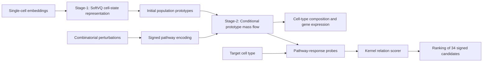

# ReproPerturb

**Population-level prediction and pathway prioritization for combinatorial perturbations in stem-cell differentiation.**

Small-molecule and protein combinations can alter both the abundance of cell states and their transcriptional profiles. ReproPerturb takes an initial cell population and a set of interventions, then predicts the endpoint cell-type composition and gene expression. The workflow was developed for stem-cell differentiation experiments that include hypoblast-like populations.

ReproPerturb connects two tasks. **Forward prediction** estimates a population’s response to a specified combination. **Pathway prioritization** starts with a target cell type, probes the trained response model across reference backgrounds and ranks 34 candidates that each specify a pathway and a direction. The same pathway can receive different scores for activation and inhibition.

**Version [v0.1.0](https://github.com/xdliulab-westlake/ReproPerturb/releases/tag/v0.1.0)** contains the model, training and evaluation code, pathway scoring workflow and benchmark implementations. Reproduction requires prepared data and checkpoints obtained separately. See the [version history](CHANGELOG.md) and [required assets](#data-and-model-assets).

## Contents

- [Model overview](#model-overview)
- [Repository structure](#repository-structure)
- [Installation](#installation)
- [Data and model assets](#data-and-model-assets)
- [Training](#training)
- [Evaluation and pathway ranking](#evaluation-and-pathway-ranking)
- [Benchmarks](#benchmarks)
- [Citation](#citation)
- [License and acknowledgements](#license-and-acknowledgements)
- [Contact](#contact)

## Model overview



### Stage-1 – Cell-state representation

Stage-1 projects precomputed scFoundation embeddings into a 128-dimensional representation and applies soft vector quantization. Four codebooks each contribute a 32-dimensional block with 128 entries. Training uses expression reconstruction and cell-type supervision. The Stage-2 pipeline summarizes a starting population with 128 prototypes derived from the Stage-1 representations, recording both the mass and presence of each prototype. The frozen Stage-1 decoder provides the expression readout for Stage-2.

See the [Stage-1 architecture](src/stage1/model.py), [training code](src/stage1/train.py) and [configuration](src/configs/stage1/stage1_softvq_hypo_hvg2000_celltype_updated_v7.py).

### Stage-2 – Conditional response prediction

The condition encoder maps each intervention to signed effects over 17 pathways. It combines those effects with a saturating sum and learns interaction corrections for combinations. The response model integrates a conditional velocity field over prototype mass in centered log-ratio coordinates. At the endpoint, predicted presence gates the masses before normalization, while predicted state shifts modify the prototype embeddings. Mapping the resulting masses to cell types gives the composition estimate. Decoding shifted prototype states and weighting by their predicted masses gives the population expression estimate.

Training supervises flow, endpoint presence, proportions and expression. The configured model also uses matched add-one pairs to supervise the incremental response when an intervention is added to a common background. See the [condition encoder](src/stage2/model/pathway_condition.py), [prototype mass flow](src/stage2/model/prototype_mass_flow.py), [training code](src/stage2/runners/train_prototype_mass_flow.py) and [configuration](configs/model.json).

### Signed pathway scoring

The pathway workflow uses 64 two-intervention backgrounds from the training split. For each background, it adjusts one pathway activity by **+1.5 or −1.5** in model activity units and computes the change in the predicted target cell-type proportion relative to the same background before the adjustment. It standardizes the 34 response features within each background and target cell type.

A kernel relation scorer trained on labeled examples combines those response features with learned pathway and direction information. The seeds share a locked relation configuration, with the kernel fitted separately for each seed. For a given cell type and signed candidate, the workflow averages the seven highest scores across the 64 backgrounds, then averages the resulting scores across seeds **43, 44 and 45**. It ranks all 34 candidates directly and retains both directions in the output.

Interpret the scores as computational priorities for the supplied reference backgrounds. The heatmaps mark cell types that lack labeled examples in the relation training set. See the [relation fitting code](src/hypo_release/unified.py), [scoring equations](src/hypo_release/shared_math.py), [scoring workflow](workflows/all_celltype_heatmaps.py) and [ranking script](scripts/rank_signed34.py).

## Repository structure

```text
ReproPerturb/
├── src/
│   ├── stage1/           # Cell-state architecture, training and validation
│   ├── stage2/           # Response architecture and training/evaluation runners
│   ├── hypo_release/     # Relation fitting and workflow helpers
│   ├── configs/          # Stage-1 Python configuration
│   ├── data/             # Shared data interfaces
│   └── scfoundation/     # Encoder support
├── configs/              # Stage-2 and locked relation configurations
├── scripts/              # Command-line entry points
├── workflows/            # Signed pathway response/scoring workflow
├── benchmarks/           # Selected final benchmark workflows
├── assets/               # Pathway definition; additional inputs required
└── requirements.txt
```

Detailed module guides: [Stage-1](src/stage1/README.md), [Stage-2](src/stage2/README.md), [benchmarks](benchmarks/README.md).

## Installation

The code targets **Python 3.10** and a CUDA-enabled PyTorch environment. The supplied dependency file pins PyTorch **2.3.1 with CUDA 11.8**. Training and response extraction require GPU access; ranking an existing score table only uses Python's standard library.

```bash
git clone --branch v0.1.0 https://github.com/xdliulab-westlake/ReproPerturb.git
cd ReproPerturb
python3.10 -m venv .venv
source .venv/bin/activate
python -m pip install --upgrade pip
python -m pip install -r requirements.txt \
  --extra-index-url https://download.pytorch.org/whl/cu118
```

Stage-1 imports `torchvision`, which is not listed in the supplied requirements file; install a version compatible with the pinned PyTorch build using the [official PyTorch installation instructions](https://pytorch.org/get-started/previous-versions/). External benchmark models require their own environments and upstream code. The installation recipe has not been validated in a fresh environment as part of this source release.

## Data and model assets

The repository does not include expression matrices, prepared pair records, checkpoints, response caches or fitted kernel parameters. Obtain the corresponding authorized assets before running model-dependent commands.

| Component | Required inputs |
| --- | --- |
| Stage-1 training | Precomputed cell embeddings, expression targets, cell-type metadata, gene indices and split definition; paths are specified in the Stage-1 configuration |
| Stage-2 training and evaluation | `weights/stage1.pt`, `assets/pair_records.pt`, `assets/pathway_base.pt`, `assets/drug_pathway_sign.csv` and `assets/stage2_split.csv`. Evaluation also requires the best Stage-2 checkpoint for the seed. |
| Response extraction | The best Stage-2 checkpoint for each seed under `weights/seed{seed}.pt`, labeled `inputs/examples_seed{seed}.pt` and `assets/context_split.csv`, along with the population and pathway inputs above. |
| Relation scoring | `configs/SHARED_CONFIG.json` and fitted `models/seed{seed}/kernel_model.npz`; fitting requires extracted response features and labeled training examples |
| Ranking only | A signed-score CSV with `seed`, `celltype`, `pathway`, `direction` and `score` columns |

Adjust dataset paths in the Stage-1 configuration and historical paths in benchmark scripts to match your environment. Prepared inputs are expected in the existing schemas; this repository does not provide a complete raw-data preparation pipeline.

## Training

Run commands from the repository root after preparing the required inputs.

### 1. Train the cell-state representation

```bash
torchrun --standalone --nproc_per_node=1 scripts/train_stage1.py
```

Training settings and output paths are defined in the [Stage-1 configuration](src/configs/stage1/stage1_softvq_hypo_hvg2000_celltype_updated_v7.py). Place the best Stage-1 checkpoint selected by validation loss at `weights/stage1.pt` for Stage-2.

### 2. Train the response model

```bash
python scripts/hypo.py train --seed 43 \
  --output /path/to/new_training_seed43
```

Repeat for seeds **44** and **45**, using a new output directory for each run. Training follows the stopping criteria in `configs/model.json` and saves `best_prototype_mass_flow.pt` at the lowest validation base loss. Copy each seed’s best checkpoint to its corresponding path under `weights/` (`seed43.pt`, `seed44.pt` or `seed45.pt`) for Stage-2 evaluation and pathway response extraction. The full model retains matched-pair supervision. The adopted run retrained Stage-2 while reusing Stage-1.

### 3. Extract features and fit the relation scorer

```bash
python scripts/hypo.py extract --seed 43
python scripts/hypo.py extract --seed 44
python scripts/hypo.py extract --seed 45
python scripts/hypo.py fit-evaluate
```

For the adopted workflow, retain the supplied locked [relation configuration](configs/SHARED_CONFIG.json). Fitting writes kernel parameters, held-out logits and directly ordered signed-candidate rankings under `models/seed{seed}/`. Existing fitted parameters are protected from overwrite.

The optional `python scripts/hypo.py select` command performs grouped training-set parameter selection. Use it only in a separate fresh experiment without an existing locked configuration; it is not required to use the supplied settings.

## Evaluation and pathway ranking

### Evaluate Stage-2 predictions

To evaluate composition and expression on the defined test split:

```bash
PYTHONPATH=src python src/stage2/runners/evaluate_prototype_mass_flow.py \
  --flow-checkpoint weights/seed43.pt \
  --pair-records assets/pair_records.pt \
  --pathway-base assets/pathway_base.pt \
  --config configs/train.py \
  --split-manifest assets/stage2_split.csv \
  --output-dir forward/seed43/test \
  --strict-test-only --evaluation-split test --device cuda
```

Repeat with the matching checkpoint and output directory for seeds 44 and 45.

### Generate and rank signed pathway scores

```bash
python workflows/all_celltype_heatmaps.py
python scripts/rank_signed34.py \
  --scores all_celltype_heatmaps/scores_all_celltypes_34.csv \
  --output signed34_rankings.csv
```

The workflow writes response features, signed relation scores and heatmaps. The ranking command averages scores across seeds 43/44/45 for each cell type and orders all 34 signed candidates. Output columns are `celltype`, `rank`, `pathway`, `direction` and `score`; equal scores share a rank. If the score CSV is already available, the ranking command can be run independently of the GPU workflow.

## Benchmarks

The benchmark uses 146 training conditions, 21 validation conditions and 14 test conditions. It evaluates seeds 43, 44 and 45 separately. The composition benchmark compares nine methods that directly predict proportions for ten cell types. For expression, predictions are evaluated over 2,000 aligned genes, with matched controls used to compute changes in expression.

| Workflow | Best checkpoint criterion |
| --- | --- |
| Stage-2 response model for pathway scoring | Lowest validation base loss |
| Composition benchmark | Lowest validation composition MAE |
| ReproPerturb expression benchmark | Highest validation gene-wise Pearson correlation |

See the [benchmark guide](benchmarks/README.md) for the methods, scoring commands, metrics and required external code.

## Citation

For analyses using this version, cite *ReproPerturb* with the release tag and record the exact commit, data split and checkpoint for each seed. Cite the upstream methods where applicable. See the [v0.1.0 source release](https://github.com/xdliulab-westlake/ReproPerturb/releases/tag/v0.1.0).

## License and acknowledgements

See [LICENSE_NOTICE.txt](LICENSE_NOTICE.txt). No blanket open-source license is assigned by this repository; upstream code, model weights and datasets retain their respective terms.

ReproPerturb uses [scFoundation](https://github.com/biomap-research/scFoundation) representations and PyTorch-based modeling components. We acknowledge the authors and maintainers of the upstream models used in the benchmarks.

## Contact

For questions about the implementation, open a [GitHub issue](https://github.com/xdliulab-westlake/ReproPerturb/issues) or contact [liaozizhuo@westlake.edu.cn](mailto:liaozizhuo@westlake.edu.cn).
