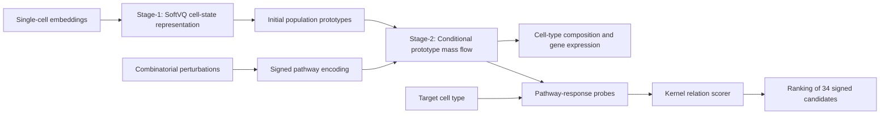

# ReproPerturb

**Modeling cellular responses to combinatorial perturbations and prioritizing signed pathway interventions.**

ReproPerturb combines a discrete cell-state representation with a conditional population response model. It predicts changes in cell-type composition and gene expression, and uses model-derived responses to score pathway interventions for a target cell type.

This repository contains the Stage-1 and Stage-2 architectures, training and evaluation code, pathway-scoring workflow, and selected benchmark scripts. Datasets and trained model weights are distributed separately from the source code; download locations are not provided in this repository.

## Contents

- [Model overview](#model-overview)
- [Repository structure](#repository-structure)
- [Installation](#installation)
- [Data and model assets](#data-and-model-assets)
- [Training](#training)
- [Evaluation and pathway ranking](#evaluation-and-pathway-ranking)
- [Benchmarks](#benchmarks)
- [Citation](#citation)
- [License and acknowledgements](#license-and-acknowledgements)
- [Contact](#contact)

## Model overview



### Stage-1: Cell-state representation

Precomputed scFoundation embeddings are projected to a 128-dimensional representation and encoded with SoftVQ. The configuration uses four codebooks, each with 128 entries of 32 dimensions. Expression reconstruction and cell-type supervision guide training. A set of 128 population prototypes summarizes the starting cell population.

**Implementation:** [architecture](src/stage1/model.py), [components](src/stage1/components/), [training](src/stage1/train.py), [configuration](src/configs/stage1/stage1_softvq_hypo_hvg2000_celltype_updated_v7.py).

### Stage-2: Conditional response prediction

A signed pathway encoder represents perturbation combinations over 17 pathways. A conditional prototype mass-flow model uses self-attention, cross-attention and time conditioning to predict changes in prototype mass, presence and state, with cell-type composition and expression readouts.

**Implementation:** [response model](src/stage2/model/prototype_mass_flow.py), [condition encoder](src/stage2/model/pathway_condition.py), [training and evaluation](src/stage2/runners/), [configuration](configs/model.json).

### Signed pathway scoring

The response model is probed at an activity perturbation strength of **1.5** for both directions of each pathway. A fitted kernel relation scorer transforms response features into 34 signed scores. Each candidate is aggregated over the highest-scoring 7 of 64 backgrounds, then averaged across seeds 43, 44 and 45.

**All 34 candidates are ranked together.** The positive and negative directions of the same pathway remain separate candidates. Scores indicate relative model priorities, not experimental concentrations, measured pathway activities or biological validation.

**Implementation:** [relation fitting](src/hypo_release/unified.py), [scoring equations](src/hypo_release/shared_math.py), [response extraction](workflows/all_celltype_heatmaps.py), [ranking](scripts/rank_signed34.py).

## Repository structure

```text
ReproPerturb/
├── src/
│   ├── stage1/           # Cell-state architecture, training and validation
│   ├── stage2/           # Response architecture and training/evaluation runners
│   ├── hypo_release/     # Relation fitting and workflow helpers
│   ├── configs/          # Stage-1 Python configuration
│   ├── data/             # Shared data interfaces
│   └── scfoundation/     # Encoder support
├── configs/              # Stage-2 and locked relation configurations
├── scripts/              # Command-line entry points
├── workflows/            # Signed pathway response/scoring workflow
├── benchmarks/           # Selected final benchmark workflows
├── assets/               # Pathway definition; additional inputs required
└── requirements.txt
```

Detailed module guides: [Stage-1](src/stage1/README.md), [Stage-2](src/stage2/README.md), [benchmarks](benchmarks/README.md).

## Installation

The code targets **Python 3.10** and a CUDA-enabled PyTorch environment. The supplied dependency file pins PyTorch **2.3.1 with CUDA 11.8**. Training and response extraction require GPU access; ranking an existing score table only uses Python's standard library.

```bash
git clone https://github.com/lzzsh/ReproPerturb.git
cd ReproPerturb
python3.10 -m venv .venv
source .venv/bin/activate
python -m pip install --upgrade pip
python -m pip install -r requirements.txt \
  --extra-index-url https://download.pytorch.org/whl/cu118
```

Stage-1 imports `torchvision`, which is not listed in the supplied requirements file; install a version compatible with the pinned PyTorch build using the [official PyTorch installation instructions](https://pytorch.org/get-started/previous-versions/). External benchmark models require their own environments and upstream code. The installation recipe has not been validated in a fresh environment as part of this source release.

## Data and model assets

The repository does not include expression matrices, prepared pair records, checkpoints, response caches or fitted kernel parameters. Obtain the corresponding authorized assets before running model-dependent commands.

| Component | Required inputs |
| --- | --- |
| Stage-1 training | Precomputed cell embeddings, expression targets, cell-type metadata, gene indices and split definition; paths are specified in the Stage-1 configuration |
| Stage-2 training/evaluation | `weights/stage1.pt`, `assets/pair_records.pt`, `assets/pathway_base.pt`, `assets/drug_pathway_sign.csv`, `assets/stage2_split.csv` and `assets/context_split.csv` |
| Response extraction | `weights/seed43.pt`, `weights/seed44.pt`, `weights/seed45.pt` and `inputs/examples_seed{seed}.pt`, in addition to the population/pathway assets |
| Relation scoring | `configs/SHARED_CONFIG.json` and fitted `models/seed{seed}/kernel_model.npz`; fitting requires extracted response features and labeled training examples |
| Ranking only | A signed-score CSV with `seed`, `celltype`, `pathway`, `direction` and `score` columns |

Adjust dataset paths in the Stage-1 configuration and historical paths in benchmark scripts to match your environment. Prepared inputs are expected in the existing schemas; this repository does not provide a complete raw-data preparation pipeline.

## Training

Run commands from the repository root after preparing the required inputs.

### 1. Train the cell-state representation

```bash
torchrun --standalone --nproc_per_node=1 scripts/train_stage1.py
```

Training settings and output paths are defined in the [Stage-1 configuration](src/configs/stage1/stage1_softvq_hypo_hvg2000_celltype_updated_v7.py). Place the selected Stage-1 checkpoint at `weights/stage1.pt` for Stage-2.

### 2. Train the response model

```bash
python scripts/hypo.py train --seed 43 --epochs 150 \
  --output /path/to/new_training_seed43
```

Repeat for seeds **44** and **45**, using a new output directory for each run. The adopted configuration uses the epoch-150 checkpoints as `weights/seed43.pt`, `weights/seed44.pt` and `weights/seed45.pt`. The full model retains matched-pair supervision. The adopted run retrained Stage-2 while reusing Stage-1.

### 3. Extract features and fit the relation scorer

```bash
python scripts/hypo.py extract --seed 43
python scripts/hypo.py extract --seed 44
python scripts/hypo.py extract --seed 45
python scripts/hypo.py fit-evaluate
```

For the adopted workflow, retain the supplied locked [relation configuration](configs/SHARED_CONFIG.json). Fitting writes kernel parameters, held-out logits and directly ordered signed-candidate rankings under `models/seed{seed}/`. Existing fitted parameters are protected from overwrite.

The optional `python scripts/hypo.py select` command performs grouped training-set parameter selection. Use it only in a separate fresh experiment without an existing locked configuration; it is not required to use the supplied settings.

## Evaluation and pathway ranking

### Evaluate Stage-2 predictions

To evaluate composition and expression on the defined test split:

```bash
PYTHONPATH=src python src/stage2/runners/evaluate_prototype_mass_flow.py \
  --flow-checkpoint weights/seed43.pt \
  --pair-records assets/pair_records.pt \
  --pathway-base assets/pathway_base.pt \
  --config configs/train.py \
  --split-manifest assets/stage2_split.csv \
  --output-dir forward/seed43/test \
  --strict-test-only --evaluation-split test --device cuda
```

Repeat with the matching checkpoint and output directory for seeds 44 and 45. This explicit command evaluates the response model without running the additional historical contextual audit bundled into `scripts/hypo.py forward`.

### Generate and rank signed pathway scores

```bash
python workflows/all_celltype_heatmaps.py
python scripts/rank_signed34.py \
  --scores all_celltype_heatmaps/scores_all_celltypes_34.csv \
  --output signed34_rankings.csv
```

The workflow writes response features, signed relation scores and heatmaps. The ranking command averages scores across seeds 43/44/45 for each cell type and orders all 34 signed candidates. Output columns are `celltype`, `rank`, `pathway`, `direction` and `score`; equal scores share a rank. If the score CSV is already available, the ranking command can be run independently of the GPU workflow.

## Benchmarks

Composition and expression use task-specific checkpoints. Each composition model predicts the ten cell-type proportions directly, with checkpoint selection by validation composition MAE. Expression checkpoint selection for ReproPerturb uses validation gene PCC. See the [benchmark guide](benchmarks/README.md) for the training scripts, per-seed evaluation command and metric definitions. The epoch-150 checkpoints described above belong to the pathway workflow.

## Citation

A manuscript citation and DOI are not specified in this repository. Until bibliographic details are available, reference the repository URL and the exact commit used for an analysis. Cite the upstream methods separately when using their code or pretrained representations.

## License and acknowledgements

See [LICENSE_NOTICE.txt](LICENSE_NOTICE.txt). No blanket open-source license is assigned by this repository; upstream code, model weights and datasets retain their respective terms.

ReproPerturb uses [scFoundation](https://github.com/biomap-research/scFoundation) representations and PyTorch-based modeling components. We acknowledge the authors and maintainers of the upstream models used in the benchmarks.

## Contact

For questions about the implementation, open a [GitHub issue](https://github.com/lzzsh/ReproPerturb/issues) or contact [liaozizhuo@westlake.edu.cn](mailto:liaozizhuo@westlake.edu.cn).
